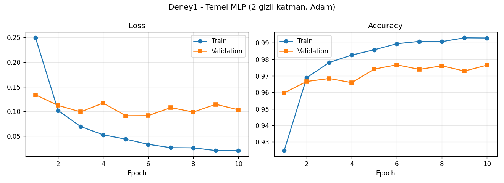
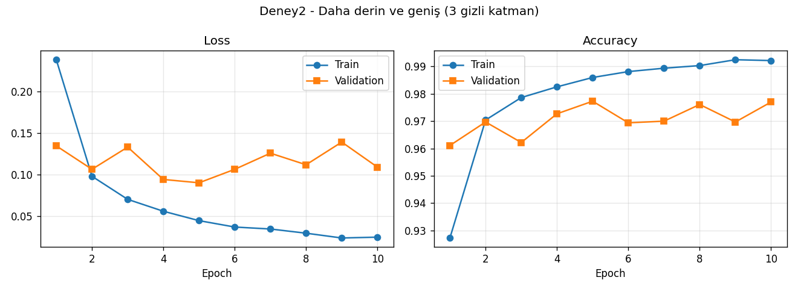
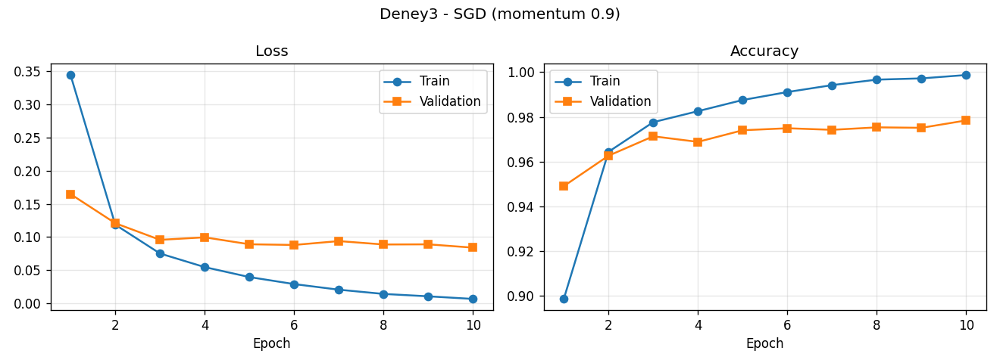
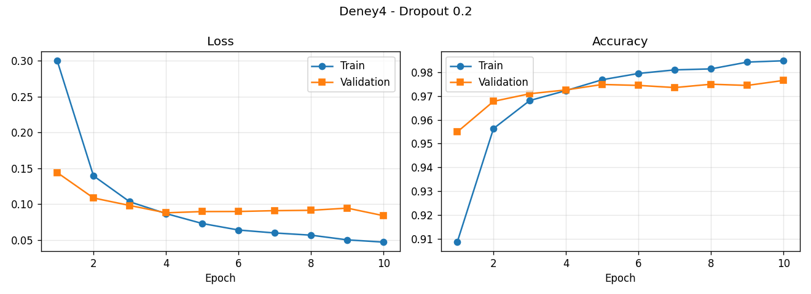
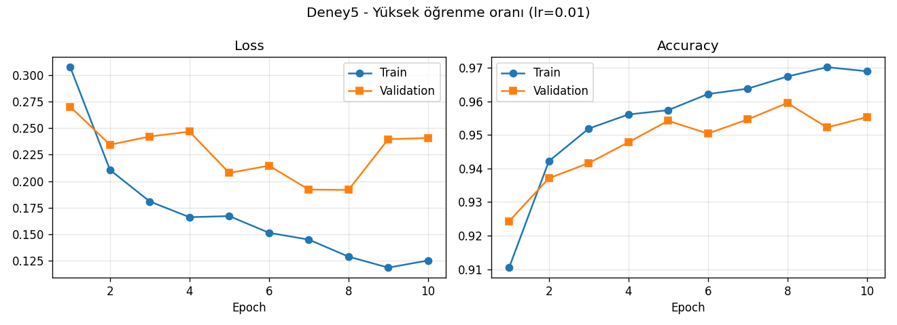
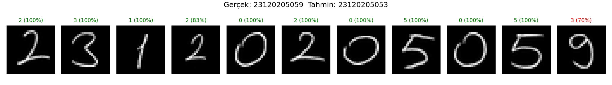

# MNIST ile MLP Tabanlı El Yazısı Rakam Tanıma

BIL485 Derin Öğrenme - Ödev 1
Ahmet Hamza Yavuz - 23120205059

Bu projede MNIST el yazısı rakam veri seti üzerinde sıfırdan bir Multi-Layer Perceptron (MLP) eğittim. Beş farklı yapılandırmayı karşılaştırdım, sonra kendi el yazımla yazdığım öğrenci numaramı modele vererek gerçek hayattaki başarısını ölçtüm. CNN veya hazır eğitilmiş model kullanmadım.

## Proje yapısı

```
mnist_mlp.py              # model, eğitim, 5 deney, grafikler
el_yazisi_test.py         # el yazısı görüntüsünü MNIST formatına çevirip modele verme
requirements.txt
egitim_log.txt            # eğitimin epoch epoch terminal çıktısı
sonuclar/
  deney1_grafik.png ... deney5_grafik.png   # loss ve accuracy grafikleri
  sonuclar.json                             # tüm metrikler ve epoch geçmişi
  en_iyi_model.pt                           # validation'a göre en iyi model
  el_yazisi_tahminler.png                   # el yazısı tahminleri
el_yazisi/
  ham/                    # telefonla çektiğim orijinal fotoğraf
  islenmis/               # 28x28'e dönüştürülmüş rakamlar
```

## Çalıştırma

```
pip install -r requirements.txt
python mnist_mlp.py                                          # 5 deneyin hepsi
python mnist_mlp.py --deney 1                                # sadece temel model
python el_yazisi_test.py --tek-resim el_yazisi/ham/numara.jpg
```

MNIST ilk çalıştırmada torchvision tarafından `veri/` klasörüne indirilir.

## Veri seti ve ayrım

MNIST: 0-9 arası el yazısı rakamlar, 28x28 gri seviye görüntüler, 10 sınıf. Piksel değerleri [0, 1] aralığına çekilip eğitim setinin ortalaması (0.1307) ve standart sapması (0.3081) ile normalize edildi.

| Küme | Örnek sayısı | Açıklama |
|---|---|---|
| Train | 50.000 | MNIST eğitim setinden, ağırlıkları öğrenmek için |
| Validation | 10.000 | MNIST eğitim setinin kalanı (sabit seed=42 ile ayrıldı), en iyi epoch ve deney seçimi için |
| Test | 10.000 | MNIST'in ayrı test seti, sadece en sonda bir kez |

Test seti eğitimde veya model seçiminde hiç kullanılmadı. Her deneyde eğitim boyunca validation accuracy'si en yüksek olan epoch'un ağırlıkları saklandı ve test sadece bu ağırlıklarla, en sonda bir kez yapıldı.

## Model

```
Flatten (28x28 -> 784)
Linear(784 -> 256) + ReLU
Linear(256 -> 128) + ReLU
Linear(128 -> 10)
```

Kayıp fonksiyonu `CrossEntropyLoss`. Bu fonksiyon softmax'ı kendi içinde uyguladığı için son katmanda ayrıca softmax yok. Ağırlıklar PyTorch'un varsayılan rastgele başlatmasıyla başlıyor, yani model sıfırdan eğitiliyor.

## Deneyler ve hiperparametreler

Tüm deneylerde batch size 64, epoch sayısı 10 ve seed 42.

| Deney | Gizli katmanlar | Optimizer | Learning rate | Dropout |
|---|---|---|---|---|
| 1 - Temel model | 256-128 | Adam | 0.001 | - |
| 2 - Daha derin/geniş | 512-256-128 | Adam | 0.001 | - |
| 3 - SGD | 256-128 | SGD (momentum 0.9) | 0.01 | - |
| 4 - Dropout | 256-128 | Adam | 0.001 | 0.2 |
| 5 - Yüksek LR | 256-128 | Adam | 0.01 | - |

Eğitim Apple M1 (MPS) üzerinde yapıldı.

## Sonuçlar

Train/val loss ve accuracy değerleri 10. epoch sonundaki değerler. Test accuracy, validation'da en iyi olan epoch'un ağırlıklarıyla ölçüldü.

| Deney | Train loss | Val loss | Train acc | Val acc | En iyi val acc (epoch) | Test acc | Eğitim süresi |
|---|---|---|---|---|---|---|---|
| 1 - Temel | 0.0205 | 0.1034 | %99.30 | %97.65 | %97.67 (6) | **%97.62** | 63.1 sn |
| 2 - Derin/geniş | 0.0248 | 0.1091 | %99.22 | %97.70 | %97.73 (5) | %97.80 | 73.6 sn |
| 3 - SGD | 0.0066 | 0.0839 | %99.87 | %97.84 | %97.84 (10) | **%98.00** | 55.2 sn |
| 4 - Dropout 0.2 | 0.0470 | 0.0838 | %98.49 | %97.66 | %97.66 (10) | **%98.00** | 63.4 sn |
| 5 - LR 0.01 | 0.1254 | 0.2407 | %96.89 | %95.53 | %95.95 (8) | %96.04 | 62.7 sn |

### Deney 1 - Temel MLP



### Diğer deneyler






## Kendi el yazımla test

Öğrenci numaramı (23120205059) beyaz kağıda mavi tükenmez kalemle, rakamlar arasında boşluk bırakarak yazdım ve telefonla fotoğrafladım (`el_yazisi/ham/numara_orijinal.jpg`). Fotoğrafta kağıt yan duruyordu ve kenarlarda kumaş görünüyordu. Bu yüzden önce sadece numaranın yazılı olduğu şeridi kırpıp 90 derece çevirdim (`el_yazisi/ham/numara.jpg`):


Bu görüntü MNIST'e benzetmek için şu adımlardan geçti:

1. Gri tonlamaya çevirme
2. Renkleri ters çevirme (MNIST'te arka plan siyah, rakam beyaz)
3. Eşikleme ile kağıt gölgesini ve dokusunu temizleme
4. Sütun boşluklarına göre fotoğrafı tek tek rakamlara ayırma
5. Her rakamın etrafındaki boşluğu kırpma
6. En-boy oranını koruyarak 20x20 kutuya sığdırma (MNIST'teki gibi)
7. 28x28 siyah tuvale yerleştirip kütle merkezini ortaya alma
8. Eğitimdekiyle aynı normalizasyon (mean=0.1307, std=0.3081)

Testte validation accuracy'si en yüksek model (Deney 3, SGD) kullanıldı.

İşlenmiş 28x28 görüntüler `el_yazisi/islenmis/` klasöründe. Grafikte her rakamın üstünde modelin tahmini ve tahminden ne kadar emin olduğu (softmax olasılığı) yazıyor.



| | |
|---|---|
| Gerçek | 23120205059 |
| Tahmin | 2312020505**3** |
| Doğru rakam | 10/11 (%90.9) |

## Değerlendirme

**Temel model (Deney 1):** İki gizli katmanlı basit bir MLP bile MNIST test setinde %97.62 doğruluğa ulaştı. Grafiklerde train loss 10 epoch boyunca sürekli düşüyor (0.25'ten 0.02'ye). Validation loss ise 5. epoch civarında en düşük değerine (0.091) iniyor, sonrasında 0.09-0.12 arasında dalgalanıyor. Train accuracy %99.3'e çıkarken validation accuracy %97.6 civarında kalıyor. Bu yaklaşık 1.7 puanlık fark, modelin 5-6. epoch'tan sonra eğitim verisini ezberlemeye (overfitting) başladığını gösteriyor. Validation'a göre en iyi epoch'u seçmem bu yüzden önemliydi.

**Derinlik ve genişlik (Deney 2):** Üçüncü bir gizli katman ekleyip katmanları genişletince parametre sayısı 235 binden 567 bine (yaklaşık 2.4 kat) çıktı, ama test doğruluğu sadece %97.62'den %97.80'e çıktı. Eğitim süresi de %17 uzadı. Validation loss'taki dalgalanma da devam etti. MNIST gibi basit bir problemde 2 gizli katmanın büyük ölçüde yeterli olduğunu, kapasiteyi artırmanın overfitting'i çözmediğini gördüm.

**Optimizer (Deney 3):** Momentumlu SGD (lr=0.01) bu deneylerin en iyi sonucunu verdi (test %98.00) ve en hızlı eğitimdi (55 sn). Adam ilk epoch'larda daha hızlı yükseliyor, ama SGD'de validation loss 10 epoch boyunca daha düzgün azaldı ve en düşük değeri son epoch'ta aldı (0.084). Train accuracy %99.87 ile neredeyse tam olduğu için daha uzun eğitimde SGD'nin de overfit etmeye başlaması beklenir.

**Dropout (Deney 4):** 0.2 dropout eklenince train accuracy %99.30'dan %98.49'a düştü, ama test doğruluğu %98.00'e çıktı. Train ile validation arasındaki fark 1.7 puandan 0.8 puana indi ve validation loss en düşük değerini son epoch'ta aldı. Dropout eğitim sırasında rastgele nöronları kapatarak modelin tek tek nöronlara bağımlı olmasını engelliyor ve bu da genellemeyi iyileştiriyor.

**Yüksek öğrenme oranı (Deney 5):** Adam ile öğrenme oranını 10 kat artırınca (0.001'den 0.01'e) en kötü sonuç çıktı: test %96.04. Hem train hem validation loss diğer deneylerden yüksek kaldı ve validation loss 0.19 ile 0.27 arasında zıplayıp durdu. Adımlar çok büyük olduğu için optimizer minimum noktasının etrafında salınıyor ve iyi bir noktaya oturamıyor.

**El yazısı ile test:** Kendi yazdığım 11 rakamın 10'u doğru tanındı (%90.9). Bu oran MNIST test setindeki %98'den belirgin şekilde düşük. 2, 3, 1, 0 ve 5 rakamlarının hepsi doğru bulundu ve çoğunda model %100'e yakın emindi. İkinci "2" doğru tahmin edildi ama güven %83'e düştü. Hata son rakamda oldu: "9"u %70 olasılıkla "3" olarak tahmin etti. İşlenmiş görüntüye bakınca benim 9'umun üst halkasının küçük ve sağa doğru açık olduğu, alt kuyruğunun da uzun ve kıvrık olduğu görülüyor. Bu şekil MNIST'teki tipik dik çizgili 9'lardan çok 3'ün alt yarısına benziyor.

Bu fark distribution shift'in, yani eğitim verisi ile gerçek veri arasındaki dağılım farkının bir örneği. MNIST'teki rakamlar kalın kalemle yazılıp taranmış; benim rakamlarım ince tükenmez kalemle yazılıp telefonla çekildi. Çizgi kalınlığı, yazı stili, ışık ve kırpma farkları modelin hiç görmediği türden girdiler oluşturuyor. Ayrıca MLP görüntüyü 784 bağımsız sayıdan oluşan düz bir vektör olarak görüyor. Rakam birkaç piksel kayınca veya biraz farklı kalınlıkta yazılınca girdi vektörü tamamen değişiyor. CNN ise komşu pikseller arasındaki yerel desenleri (halka, çizgi, köşe) öğrendiği ve kaymaya karşı daha dayanıklı olduğu için bu konuda daha başarılı olurdu. MLP ile sonucu iyileştirmek için şunlar denenebilir: çizgileri MNIST'teki kadar kalınlaştırmak (morfolojik genişletme), eğitimde döndürme, kaydırma ve kalınlık değişimi gibi veri artırma (data augmentation) uygulamak ya da modeli birkaç farklı kişinin el yazısıyla ince ayar yapmak.

**Genel sonuç:** MNIST üzerinde MLP ile %98 civarında başarıya ulaşmak mümkün. Hiperparametreler arasında en büyük etkiyi öğrenme oranı yaptı: yanlış bir değer, mimariyi değiştirmekten daha fazla zarar verdi. Overfitting'e karşı en etkili yöntemler dropout ve validation'a göre en iyi epoch'u seçmek oldu. Kendi el yazımdaki %90.9'luk başarı ise test setindeki yüksek başarının gerçek hayata birebir taşınmadığını, eğitim verisine benzemeyen girdilerde modelin zorlandığını gösterdi.
